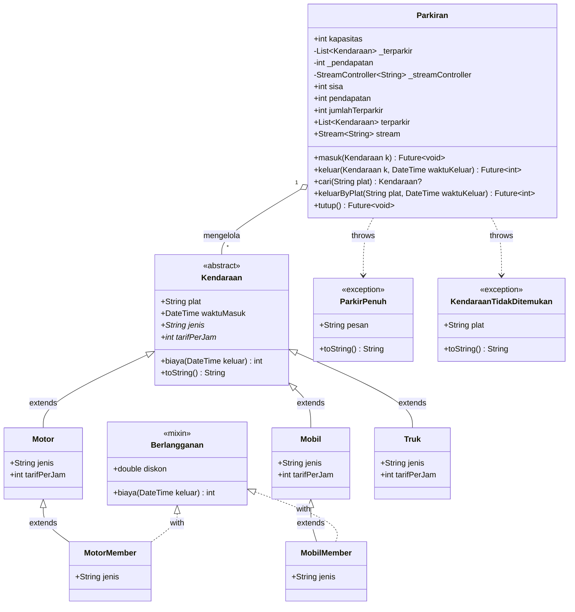

# Tugas Rutin 4: Sistem Parkir Kampus FMIPA (Console)

## Identitas Mahasiswa

- **Nama**: Bryant Tinambunan
- **NIM**: 4241250015
- **Mata Kuliah**: Pemrograman Mobile (3KOM40215)
- **Program Studi**: Ilmu Komputer, Universitas Negeri Medan (UNIMED)
- **Pertemuan**: 4 (Object-Oriented Programming dan Async Programming di Dart)

---

## Deskripsi Program

Aplikasi console ini mengimplementasikan sistem parkir cerdas untuk area kampus FMIPA Universitas Negeri Medan. Sistem ini memadukan konsep inti **Object-Oriented Programming (OOP)** seperti *class*, *abstract class*, *inheritance*, *encapsulation*, *mixin*, dan *polymorphism*, serta **Asynchronous Programming** menggunakan `Future`, `async/await`, dan siaran kejadian secara *real-time* menggunakan `StreamController.broadcast()`.

Kendaraan masuk dan keluar disimulasikan melalui palang otomatis asinkron, tarif dihitung per jam sesuai jenis kendaraan dengan pembulatan ke atas (minimal 1 jam), serta potongan tarif 50% untuk member menggunakan mixin. Apabila kapasitas terlampaui, sistem melempar custom exception `ParkirPenuh`.

---

## Diagram Kelas (Class Diagram)



---

## Petunjuk Menjalankan Program

### 1. Menjalankan Program Utama

Dari direktori root proyek (`pm_p4_4241250015`), jalankan perintah:

```shell
dart run
```
atau
```shell
dart run bin/pm_p4_4241250015.dart
```

### 2. Menjalankan Pengujian Otomatis (Unit Test)

Seluruh logika tarif, pembulatan durasi, mixin member, kapasitas parkir, exception handling, dan aliran Stream diuji menggunakan:

```shell
dart test
```

### 3. Analisis Kerapian Kode (Linter)

Memastikan kode bersih tanpa warning dan error berdasarkan standar *Effective Dart*:

```shell
dart analyze
```

---

## Tangkapan Layar & Log Keluaran Terminal

Berikut adalah tangkapan layar hasil eksekusi terminal ketika program dijalankan:


```text
MASUK Motor BK 1234 AB (sisa 2)
MASUK Mobil BK 88 UN (sisa 1)
MASUK Mobil (member) BK 7 MIPA (sisa 0)
Ditolak: Parkiran penuh (kapasitas 3)
KELUAR Motor BK 1234 AB bayar Rp6000
KELUAR Mobil BK 88 UN bayar Rp15000
KELUAR Mobil (member) BK 7 MIPA bayar Rp7500
Pendapatan: Rp28500
```

---

## Penjelasan Penerapan Enkapsulasi, Polimorfisme, dan Async (155 Kata)

Enkapsulasi diterapkan pada kelas `Parkiran` dengan menyembunyikan status internal melalui atribut privat `_terparkir` (daftar kendaraan yang sedang parkir) dan `_pendapatan` (akumulasi tarif yang terkumpul). Akses dari luar dikendalikan secara aman melalui getter publik `sisa`, `pendapatan`, dan `terparkir` yang mengembalikan koleksi *unmodifiable* sehingga tidak dapat dimanipulasi langsung oleh kode luar.

Polimorfisme diwujudkan melalui kelas abstrak `Kendaraan` yang diturunkan oleh `Motor`, `Mobil`, `Truk`, serta kelas ber-mixin `MobilMember`. Pada fungsi `main`, seluruh objek kendaraan disimpan dan diperlakukan seragam dalam `List<Kendaraan>`. Pemanggilan metode `biaya(keluar)` secara dinamis mengeksekusi implementasi tarif dan diskon 50% spesifik milik subclass masing-masing saat runtime (*dynamic dispatch*).

Pemrograman asinkron (*async*) diterapkan pada operasi palang gerbang parkir otomatis melalui metode `masuk()` dan `keluar()` yang memanfaatkan `Future.delayed` dengan `async/await` agar tidak memblokir thread eksekusi utama. Selain itu, setiap transaksi masuk dan keluar dipancarkan secara *real-time* ke pos jaga menggunakan `StreamController.broadcast()` yang ditangkap secara reaktif oleh *listener*.

---

## Pernyataan Penggunaan AI

Pengembangan program ini (perancangan arsitektur kelas, implementasi mixin & StreamController, pembuatan unit test komprehensif, serta penyusunan dokumentasi) dibantu oleh asisten AI (Google DeepMind Antigravity). Seluruh implementasi kode telah diuji secara menyeluruh melalui `dart test` (13 pengujian lulus) dan diverifikasi kebersihannya dengan `dart analyze` tanpa ada error maupun warning.

---

## Lampiran: Jawaban Latihan Mandiri & Pertanyaan Refleksi Modul 4

### E. Latihan Mandiri (Pilihan Ganda)

1. **Jawaban: b. konstruktor dengan initializing formal**  
   *Penjelasan*: Dart menyediakan *initializing formals* (`this.field`) untuk menyederhanakan pengisian variabel instans langsung dari parameter konstruktor.
2. **Jawaban: b. kode apa pun di berkas yang sama**  
   *Penjelasan*: Privasi di Dart berakar pada tingkat *library* (berkas), bukan tingkat kelas. Variabel berawalan `_` dapat diakses oleh semua kode dalam satu berkas yang sama.
3. **Jawaban: b. implements banyak interface dan memakai banyak mixin**  
   *Penjelasan*: Dart mendukung pewarisan tunggal (*single inheritance*) untuk `extends`, tetapi sebuah kelas dapat mengimplementasikan banyak antarmuka (`implements`) dan menggabungkan banyak mixin (`with`).
4. **Jawaban: b. Buku**  
   *Penjelasan*: Karena prinsip polimorfisme (*dynamic dispatch*), metode yang dieksekusi adalah implementasi milik objek nyata pada saat *runtime* (yaitu `Buku`), bukan tipe referensi variabelnya (`Koleksi`).
5. **Jawaban: b. async**  
   *Penjelasan*: Kata kunci `await` hanya sah digunakan di dalam badan fungsi yang dideklarasikan dengan penanda `async`.
6. **Jawaban: b. 2 detik**  
   *Penjelasan*: `(f1, f2).wait` menjalankan kedua *Future* secara konkuren. Total waktu tunggu mendekati durasi *Future* yang paling lama (2 detik), bukan akumulasi keduanya (3 detik).
7. **Jawaban: b. async\***  
   *Penjelasan*: Fungsi generator asinkron yang memancarkan serangkaian nilai ke dalam `Stream` menggunakan kata kunci `async*` dan `yield`.
8. **Jawaban: b. StreamController.broadcast()**  
   *Penjelasan*: Stream biasa bersifat *single-subscription* (hanya boleh satu pendengar). Konstruktor `.broadcast()` memungkinkan banyak listener berlangganan secara bersamaan.
9. **Jawaban: b. dimiliki kelas dan diakses lewat nama kelas**  
   *Penjelasan*: Anggota `static` terikat pada kelas itu sendiri dan diakses langsung melalui nama kelas (misal `Mahasiswa.kampus`), bukan melalui instans objek.
10. **Jawaban: b. 2**  
    *Penjelasan*: Nilai indeks pada *enum* Dart dimulai dari 0 (`senin: 0`, `selasa: 1`, `rabu: 2`).
11. **Jawaban: c. terbesar(['a', 'b'])**  
    *Penjelasan*: Batasan tipe generik `T extends num` mengharuskan parameter berupa tipe angka (`int` atau `double`). Pemanggilan dengan `String` akan ditolak oleh compiler.
12. **Jawaban: c. whenComplete**  
    *Penjelasan*: Callback `whenComplete` selalu dieksekusi setelah *Future* selesai, baik ketika menghasilkan nilai sukses maupun terjadi *error* (analog dengan blok `finally`).

### E. Latihan Mandiri (Uraian)

1. **Urutan Keluaran Program & Alasan**:
   ```dart
   Future<void> main() async {
     print('A');
     Future.delayed(Duration.zero, () => print('B'));
     await Future.delayed(const Duration(milliseconds: 10));
     print('C');
     final f = Future(() => print('D'));
     print('E');
     await f;
     print('F');
   }
   ```
   **Urutan Keluaran**: `A` $\rightarrow$ `B` $\rightarrow$ `C` $\rightarrow$ `E` $\rightarrow$ `D` $\rightarrow$ `F`.  
   **Alasan**:
   - `print('A')` berjalan sinkron dan langsung dicetak.
   - `Future.delayed(Duration.zero, ...)` menjadwalkan pencetakan `'B'` ke *event loop*.
   - `await Future.delayed(10 ms)` menunda eksekusi `main()` dan memberi kesempatan *event loop* mengeksekusi antrean yang siap, sehingga `'B'` tercetak.
   - Setelah penundaan 10 ms tuntas, program melanjutkan ke `print('C')`.
   - `final f = Future(...)` menjadwalkan pencetakan `'D'` ke *event loop*, namun kode sinkron berikutnya `print('E')` langsung dieksekusi terlebih dahulu.
   - Pemanggilan `await f` menunggu penyelesaian callback `f`, mencetak `'D'`, dan akhirnya mengeksekusi baris penutup `print('F')`.

2. **Rancangan Kelas Sistem Presensi Kuliah**:
   - **`abstract class Pengguna`**: Mewakili cetak biru entitas dasar kampus (`id`, `nama`). Tepat dijadikan *abstract class* karena memiliki *state* dan kode dasar yang diwarisi oleh subclass, namun tidak boleh diinstansiasi secara mandiri.
   - **`class Mahasiswa extends Pengguna` & `class Dosen extends Pengguna`**: Kelas konkret turunan pengguna.
   - **`abstract interface class BisaPresensi`**: Digunakan sebagai kontrak interface murni yang mendefinisikan tanda tangan metode `bool validasiPresensi(String kode)`. Menggunakan `interface class` karena merepresentasikan kontrak kemampuan perilaku (*behavior contract*) murni tanpa membawa implementasi *state*.
   - **`mixin PresensiQr` & `mixin PresensiManual`**: Kumpulan fungsi cara verifikasi yang dapat dicampurkan (*pluggable*) ke kelas model presensi pertemuan tanpa membentuk hierarki pewarisan yang rumit.

   ```dart
   abstract class Pengguna {
     final String id;
     final String nama;
     Pengguna(this.id, this.nama);
   }

   abstract interface class BisaPresensi {
     bool validasiPresensi(String data);
   }

   mixin PresensiQr {
     bool scanQr(String qrPayload) => qrPayload.startsWith('UNIMED_');
   }

   mixin PresensiManual {
     bool verifikasiManual(String tandaTangan) => tandaTangan.isNotEmpty;
   }

   class Pertemuan with PresensiQr, PresensiManual implements BisaPresensi {
     final int sesi;
     final String materi;
     Pertemuan(this.sesi, this.materi);

     @override
     bool validasiPresensi(String data) => scanQr(data) || verifikasiManual(data);
   }
   ```

### C. Pertanyaan Refleksi Modul

1. **Kapan Anda memilih extends, implements, atau with? Berikan contoh dari sistem akademik kampus.**  
   *Jawaban*:
   - Gunakan `extends` untuk hubungan hierarki "adalah sebuah" (*is-a*) dengan pewarisan kode tunggal. *Contoh*: `Dosen extends Pegawai`.
   - Gunakan `implements` saat sebuah kelas harus memenuhi kontrak perilaku tertentu tanpa mewarisi implementasi internal superclass, serta memungkinkan implementasi banyak antarmuka. *Contoh*: `Mahasiswa implements AksesPerpustakaan, LayananKesehatan`.
   - Gunakan `with` (mixin) untuk menambahkan kemampuan fungsional siap pakai yang dapat digunakan bersama oleh berbagai kelas yang berbeda hierarki. *Contoh*: `mixin NotifikasiEmail` yang dapat dipasangkan ke `Dosen with NotifikasiEmail` maupun `BagianAkademik with NotifikasiEmail`.

2. **Mengapa await di dalam pinjam tidak membuat seluruh program berhenti?**  
   *Jawaban*: Dart beroperasi menggunakan mekanisme *single-threaded event loop*. Kata kunci `await` hanya menunda eksekusi lokal dari fungsi asinkron tersebut dan melepaskan kendali thread kembali ke *event loop*. Akibatnya, operasi lain seperti pemrosesan antrean *Stream*, timer, serta interaksi pengguna tetap dapat berjalan secara responsif tanpa membekukan program.

3. **Apa perbedaan Future dan Stream? Sebutkan satu contoh masing-masing pada aplikasi mobile yang Anda pakai sehari-hari.**  
   *Jawaban*:
   - *Future*: Merepresentasikan hasil operasi tunggal (satu nilai atau satu error) yang akan selesai pada satu waktu di masa mendatang. *Contoh*: Melakukan *login* atau memuat profil pengguna dari REST API saat membuka aplikasi SIAKAD UNIMED / Instagram.
   - *Stream*: Merepresentasikan aliran data berkelanjutan yang memancarkan nol atau banyak nilai secara bertahap dari waktu ke waktu hingga ditutup. *Contoh*: Pembaruan posisi lokasi GPS secara langsung (*live tracking*) pada peta aplikasi Gojek / Maxim, atau pesan obrolan yang masuk secara *real-time* di WhatsApp.