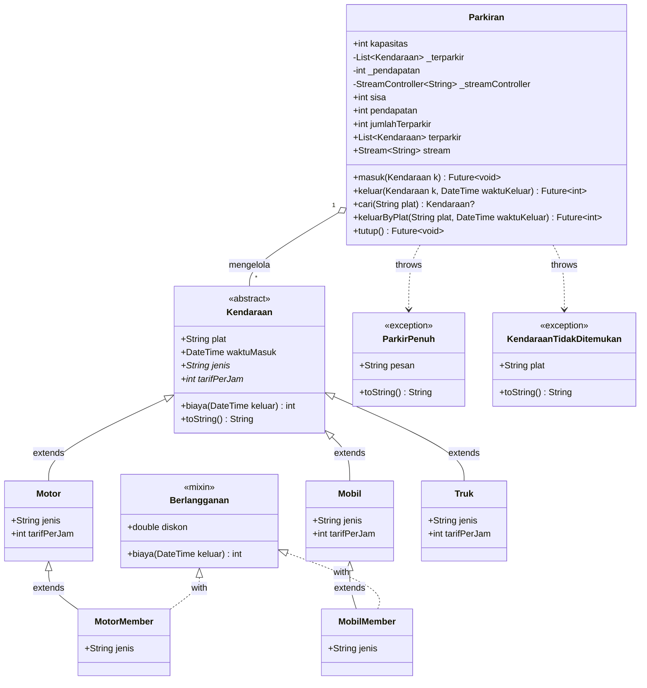
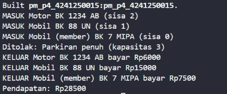

# Tugas Rutin 4: Sistem Parkir Kampus FMIPA (Console)

## Identitas Mahasiswa

- **Nama**: Bryant Tinambunan
- **NIM**: 4241250015
- **Mata Kuliah**: Pemrograman Mobile (3KOM40215)
- **Program Studi**: Ilmu Komputer, Universitas Negeri Medan (UNIMED)
- **Pertemuan**: 4 (Object-Oriented Programming dan Async Programming di Dart)

---

## Deskripsi Program

Aplikasi console ini mengimplementasikan sistem parkir cerdas untuk area kampus FMIPA Universitas Negeri Medan. Sistem ini memadukan konsep inti **Object-Oriented Programming (OOP)** seperti *class*, *abstract class*, *inheritance*, *encapsulation*, *mixin*, dan *polymorphism*, serta **Asynchronous Programming** menggunakan `Future`, `async/await`, dan siaran kejadian secara *real-time* menggunakan `StreamController.broadcast()`.

Kendaraan masuk dan keluar disimulasikan melalui palang otomatis asinkron, tarif dihitung per jam sesuai jenis kendaraan dengan pembulatan ke atas (minimal 1 jam), serta potongan tarif 50% untuk member menggunakan mixin. Apabila kapasitas terlampaui, sistem melempar custom exception `ParkirPenuh`.

---

## Diagram Kelas (Class Diagram)



---

## Petunjuk Menjalankan Program

### 1. Menjalankan Program Utama

Dari direktori root proyek (`pm_p4_4241250015`), jalankan perintah:

```shell
dart run
```
atau
```shell
dart run bin/pm_p4_4241250015.dart
```

### 2. Menjalankan Pengujian Otomatis (Unit Test)

Seluruh logika tarif, pembulatan durasi, mixin member, kapasitas parkir, exception handling, dan aliran Stream diuji menggunakan:

```shell
dart test
```

### 3. Analisis Kerapian Kode (Linter)

Memastikan kode bersih tanpa warning dan error berdasarkan standar *Effective Dart*:

```shell
dart analyze
```

---

## Tangkapan Layar & Log Keluaran Terminal

Berikut adalah tangkapan layar hasil eksekusi terminal ketika program dijalankan:



```text
MASUK Motor BK 1234 AB (sisa 2)
MASUK Mobil BK 88 UN (sisa 1)
MASUK Mobil (member) BK 7 MIPA (sisa 0)
Ditolak: Parkiran penuh (kapasitas 3)
KELUAR Motor BK 1234 AB bayar Rp6000
KELUAR Mobil BK 88 UN bayar Rp15000
KELUAR Mobil (member) BK 7 MIPA bayar Rp7500
Pendapatan: Rp28500
```

---

## Penjelasan Penerapan Enkapsulasi, Polimorfisme, dan Async (155 Kata)

Enkapsulasi diterapkan pada kelas `Parkiran` dengan menyembunyikan status internal melalui atribut privat `_terparkir` (daftar kendaraan yang sedang parkir) dan `_pendapatan` (akumulasi tarif yang terkumpul). Akses dari luar dikendalikan secara aman melalui getter publik `sisa`, `pendapatan`, dan `terparkir` yang mengembalikan koleksi *unmodifiable* sehingga tidak dapat dimanipulasi langsung oleh kode luar.

Polimorfisme diwujudkan melalui kelas abstrak `Kendaraan` yang diturunkan oleh `Motor`, `Mobil`, `Truk`, serta kelas ber-mixin `MobilMember`. Pada fungsi `main`, seluruh objek kendaraan disimpan dan diperlakukan seragam dalam `List<Kendaraan>`. Pemanggilan metode `biaya(keluar)` secara dinamis mengeksekusi implementasi tarif dan diskon 50% spesifik milik subclass masing-masing saat runtime (*dynamic dispatch*).

Pemrograman asinkron (*async*) diterapkan pada operasi palang gerbang parkir otomatis melalui metode `masuk()` dan `keluar()` yang memanfaatkan `Future.delayed` dengan `async/await` agar tidak memblokir thread eksekusi utama. Selain itu, setiap transaksi masuk dan keluar dipancarkan secara *real-time* ke pos jaga menggunakan `StreamController.broadcast()` yang ditangkap secara reaktif oleh *listener*.

---

## Pernyataan Penggunaan AI

Pengembangan program ini (perancangan arsitektur kelas, implementasi mixin & StreamController, pembuatan unit test komprehensif, serta penyusunan dokumentasi) dibantu oleh asisten AI (Google DeepMind Antigravity). Seluruh implementasi kode telah diuji secara menyeluruh melalui `dart test` (13 pengujian lulus) dan diverifikasi kebersihannya dengan `dart analyze` tanpa ada error maupun warning.

---

